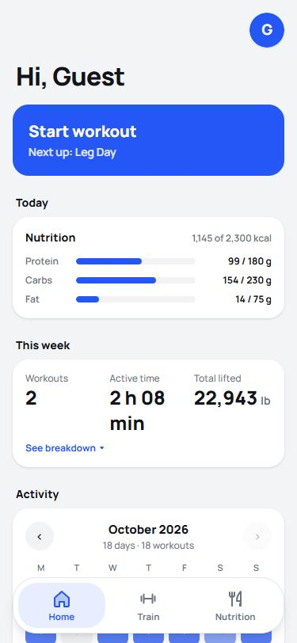
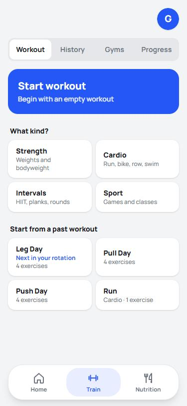
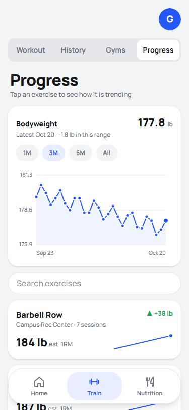
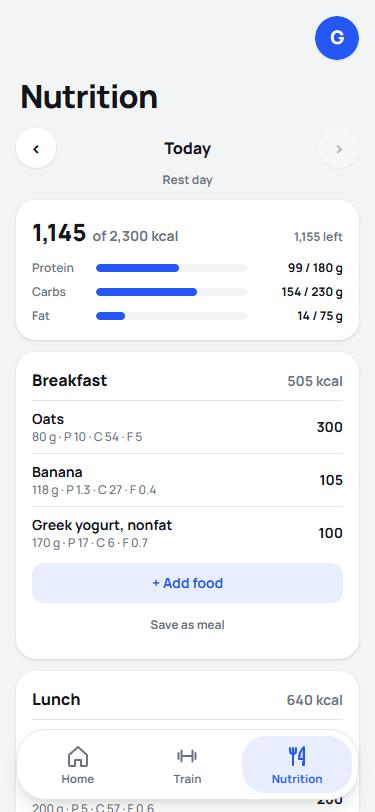
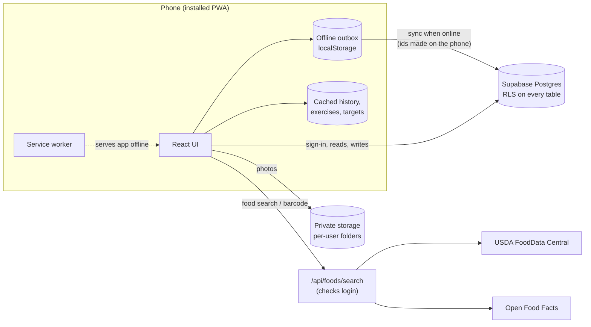

# Gym Companion

A workout and nutrition tracker that installs on your phone like an app and keeps working with no signal at the gym. I use it at the gym, and so do a few friends.

**Live app:** https://gym-app-three-sand.vercel.app. Tap **Look around as a guest** on the sign-in screen to get your own private copy filled with four weeks of sample workouts, food and bodyweight, with no sign-up needed. Guest accounts are deleted after 7 days.

<p>
  
  
  
  
</p>

## What it does

**Training**
- Logs strength, cardio, interval and sport workouts. Strength sets record weight and reps, including warm-ups, partial reps, single-arm left/right reps and supersets. Cardio records time, distance and pace.
- Remembers each gym's machines and your seat and pin settings, with photos, so the next session starts where you left off.
- Suggests the next weight from your last session, and shows the workout that usually comes next in your rotation.
- Progress charts per exercise (estimated 1RM, top weight, volume), personal bests, a bodyweight trend, and a training calendar with streaks.
- History with filters, repeat-a-past-workout, and CSV export of every set.

**Nutrition**
- Daily calories and macros against your targets, with separate targets for training days and rest days.
- Food search across USDA FoodData Central and Open Food Facts, a barcode scanner, saved foods and saved meals, and custom meal names.

**Everywhere**
- Works offline: finished workouts are saved on the phone and sync later with no duplicates.
- Installable (PWA), light and dark themes, lb or kg (stored in kg).

## Tech stack

| Layer | Choice |
|---|---|
| Frontend | Next.js 15 (App Router), React 19, TypeScript, Tailwind CSS v4 |
| Backend | Supabase: Postgres with row-level security, Auth, private Storage |
| Hosting | Vercel (every push to `main` deploys) |
| Food data | USDA FoodData Central and Open Food Facts, through a server route |
| Development | Built with Claude Code (AI coding assistant); see "How it was built" below |

## How it works



**Offline sync.** Every set gets its id on the phone, so a save that is retried after a dropped connection updates the same row instead of making a duplicate. Finished workouts wait in an outbox and sync when there's signal. If the database refuses one workout, it stays on the phone with its error and the others still sync.

**Security.** Row-level security limits every table to the signed-in user's rows. Database triggers also refuse any row that points at another account's gym, exercise or workout, even if an id were guessed. Signed-out users have no table access, photos live in private per-user folders with size and type limits, and the USDA key stays on the server. The food-search route checks the user's login before it uses the key.

**Barcode scanning.** iPhone browsers have no built-in barcode reader, so `src/lib/barcode.ts` decodes EAN-13, UPC-A and EAN-8 from the camera picture itself: it finds edges, matches bar widths against the digit tables, verifies the checksum and reads in both directions.

**Database changes** are numbered migrations in [`supabase/migrations`](supabase/migrations), and every change has an entry in [`CHANGELOG.md`](CHANGELOG.md).

## How it was built

I built this with Claude Code, an AI coding assistant, and treated it like a teammate I was leading:

- **I owned the product.** I set the requirements and the roadmap (workout logger, then nutrition, then training plus nutrition, then an AI coach), and I made every design and wording decision from options the assistant proposed.
- **I wrote the rules it follows.** [`CLAUDE.md`](CLAUDE.md) records the stack, the commit and migration process, unit rules and when to ask me first, so every session works the same way.
- **I verified instead of trusting.** Type checks before every release, fixture tests for the parsers, the barcode decoder and the target math, review of every database change before it was applied, a security audit with fixes, and testing on a real phone.

## Run it locally

1. Create a free Supabase project and run the files in `supabase/migrations` in order (SQL Editor or `supabase db push`).
2. Copy `.env.example` to `.env.local` and fill in your project URL and publishable key. Food search also needs a free `USDA_API_KEY` from api.data.gov (optional; Open Food Facts works without it).
3. To use the guest demo, turn on **Authentication → Allow anonymous sign-ins** in Supabase.
4. Install and run:

```
npm install
npm run dev
```

Then open http://localhost:3000.

## Roadmap

- [x] Phase 1: workout logger
- [x] Phase 2: nutrition tracker
- [x] Phase 3: training plus nutrition (training-day targets, bodyweight trend, next workout)
- [ ] Phase 4: AI coach grounded in your own logged data
